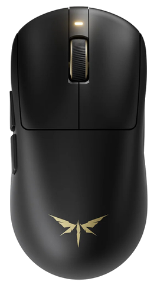

<div align="center">



# 🖱️ VGN Hub Linux

**Ứng dụng Desktop (GTK4 + Libadwaita + WebKitGTK6 Dark Glass) & CLI thuần Linux cho chuột gaming VGN Dragonfly 3 Ultra và các dòng `vgn-ry-mouse`** — chạy trực tiếp qua `/dev/hidraw*` bằng Python stdlib, **không cần `pip` hay `npm` ngoài**.

<p>
  <a href="https://github.com/hoangtl2/vgn-hub-linux/actions/workflows/test.yml">
    
  </a>
  
  
  
  
  
  <a href="LICENSE">
    
  </a>
</p>

<p>
  <a href="#features">✨ Tính năng</a> ·
  <a href="#devices">🖱️ Thiết bị hỗ trợ</a> ·
  <a href="#install">📦 Cài đặt</a> ·
  <a href="#usage">🚀 Sử dụng</a> ·
  <a href="#waybar">📊 Waybar</a> ·
  <a href="#architecture">🏗️ Kiến trúc</a> ·
  <a href="#testing">🧪 Kiểm thử</a>
</p>

</div>

---

<a id="features"></a>
## ✨ Tính năng nổi bật

### 🎨 Giao diện Desktop hiện đại (GTK4 + WebKitGTK6)

- 🏠 **Device Lobby & Quét thiết bị HID**: Màn hình chờ chọn thiết bị khi mở app, hộp thoại **+ Thêm thiết bị** quét trực tiếp `/dev/hidraw*`, kiểm tra quyền `udev`, tùy chọn 4 màu vỏ hiển thị trên thẻ chuột (*Đen Obsidian*, *Trắng Bạc Frost*, *Hồng Sakura*, *Cam Sunset*).
- 🖼️ **Wallpaper Studio & Dark Glass / Solid**: Nút **Hình nền** góc trên phải với 6 chủ đề gradient có sẵn (*VGN Crimson*, *Obsidian Aurora*, *Cyber Indigo*, *Dragonfly Gold*, *Emerald Pulse*, *Minimal Graphite*) hoặc chọn ảnh tùy chỉnh (`PNG`, `JPG`, `WEBP`, `AVIF`, `BMP`, `GIF` tối đa 30 MB), chỉnh `Blur` / `Dim` / `Opacity`, tự động thu nhỏ ảnh lớn về cạnh dài tối đa `2560px` và tắt CSS blur khi `blur = 0` để tối ưu RAM/GPU; chuyển nhanh **Dark Glass / Solid** và **Tiếng Việt / English**.
- 🐉 **Hình chuột thật & Live Telemetry**: Logo chuồn chuồn VGN vàng kim loại, ảnh render thật mặt trên & mặt đáy **Dragonfly 3 Ultra** với **đèn LED DPI trực tiếp (live DPI LED overlay)**, hotspot tương tác từng nút và cột **Thông số nhanh** theo thời gian thực.
- 🎮 **Chế độ Demo không cần cắm chuột**: Trải nghiệm toàn bộ giao diện qua `vgn-hub-gui --demo` hoặc chuyển đổi ngay trong ứng dụng.

### ⚙️ Điều khiển phần cứng toàn diện

- 🖱️ **Gán nút (Key Binding — 6 nút)**: Chuột trái/phải/giữa, nút hông Tiến/Lùi, nút DPI đáy, cuộn/nghiêng, tổ hợp phím bàn phím (tối đa 3 phím như `Ctrl + Shift + C`), phím Multimedia/System, Macro hoặc Disable.
- 🎯 **Cài đặt DPI (1–6 nấc, `50–42,000 DPI`)**: Bước chỉnh `50 DPI`, tách riêng trục `X / Y`, preset Esports nhanh, đổi màu LED từng nấc và đồng bộ realtime khi bấm nút DPI vật lý dưới đáy chuột.
- ⚡ **Hiệu năng (Performance)**: Chọn **Polling Rate** `125Hz → 8000Hz` (`125 / 250 / 500 / 1000 / 2000 / 4000 / 8000Hz`) và **Sensor Sampling Rate** (`Basic Mode` / `Supreme Competitive ≥20K FPS`).
- 🎹 **Macro Editor (16 slot)**: Ghi trực tiếp thao tác phím & chuột kèm độ trễ thực tế (ms), chỉnh từng bước/số lần lặp và nạp thẳng vào bộ nhớ chuột.
- 🧭 **Sensor Rotation (`-90° .. +90°`)**: Núm xoay cảm biến thiết kế mới với vạch chia chi tiết, mô phỏng góc chuột realtime và debounce thao tác ghi xuống phần cứng.
- 🔧 **Thông số cảm biến (Parameters)**: `LOD (0.7 / 1 / 2mm)`, `Latency Mode (Stable / Extreme)`, `Motion Sync`, `Button Debounce (1 / 2 / 3 / 4 / 8 / 15 / 20ms)`, `Straight-Line Correction (Angle Snapping)`, `Wave Control (Ripple Control)`, `Sleep Timer (10s / 30s / 1m / 2m / 5m / 10m)`.
- 💾 **Profile 1–4, Sao lưu JSON & Factory Reset**: Chuyển nhanh 4 profile trên phần cứng, xuất/nhập cấu hình JSON và khôi phục mặc định nhà sản xuất.
- 🔋 **Theo dõi Pin & Waybar**: Đọc `% pin` qua cả dây USB lẫn receiver 2.4GHz (nhận diện trạng thái ngủ), hỗ trợ xuất JSON chuẩn cho **Waybar**.

---

<a id="devices"></a>
## 🖱️ Thiết bị hỗ trợ

Tất cả thiết bị thuộc họ giao thức `vgn-ry-mouse` (Vendor ID `391d`):

| Thiết bị | Sensor | DPI hỗ trợ | Polling tối đa | USB Wired | Dongle 2.4GHz | Trạng thái |
|---|---|---|---|---|---|---|
| **VGN Dragonfly 3 Ultra** | `PAW3950` | `50–42,000` | `8000Hz` | `391d:1028` | `391d:1a25` | ✅ Đã kiểm chứng |
| **VGN Dragonfly F1 V5 Ultra** | `PAW3950` | `50–42,000` | `8000Hz` | `391d:102f` | `391d:1a2b` | 🧪 Cùng giao thức |
| **VGN Dragonfly F2 V2 Ultra** | `PAW3950` | `50–42,000` | `8000Hz` | `391d:1048` | `391d:1a41` | 🧪 Cùng giao thức |
| **VGN Dragonfly 3 Pro Max** | `PAW3395` | `50–36,000` | `8000Hz` | `391d:1004` | `391d:1a04` | 🧪 Cùng giao thức |
| **VGN Dragonfly Y2 V2 Pro Max** | `PAW3395` | `50–36,000` | `8000Hz` | `391d:1008` | `391d:1a08` | 🧪 Cùng giao thức |
| **VGN Dragonfly F1 V2 Pro Max** | `PAW3395` | `50–36,000` | `8000Hz` | `391d:1015` | `391d:1a13` | 🧪 Cùng giao thức |

> [!NOTE]
> - Cảm biến `PAW3950` hỗ trợ các mức LOD `0.7 / 1 / 2mm`, trong khi `PAW3395` hỗ trợ `1 / 2mm`.
> - Driver hiện chưa hỗ trợ kết nối **Bluetooth** — vui lòng sử dụng dây cáp USB hoặc receiver 2.4GHz.

---

<a id="install"></a>
## 📦 Yêu cầu & Cài đặt

### 🧩 Yêu cầu hệ thống

- 🐧 Linux có hỗ trợ `/dev/hidraw*` và **Python `>= 3.11`**
- 🪟 Gói hệ thống **GTK4 + Libadwaita + WebKitGTK6 (`PyGObject`)** *(chỉ cần cho GUI; CLI chạy thuần Python stdlib)*:

| Distro | Lệnh cài đặt gói hệ thống |
|---|---|
| 🎩 **Fedora** | `sudo dnf install python3-gobject gtk4 libadwaita webkitgtk6.0` |
| 🏔️ **Arch Linux** | `sudo pacman -S python-gobject gtk4 libadwaita webkitgtk-6.0` |
| 🟠 **Ubuntu / Debian** | `sudo apt install python3-gi gir1.2-gtk-4.0 gir1.2-adw-1 gir1.2-webkit-6.0` |

### ⚡ Cài đặt nhanh

```bash
git clone https://github.com/hoangtl2/vgn-hub-linux.git
cd vgn-hub-linux
./scripts/install.sh
```

Script [`scripts/install.sh`](scripts/install.sh) sẽ tạo symlink `vgn-hub` và `vgn-hub-gui` vào `~/.local/bin` (hãy đảm bảo `~/.local/bin` nằm trong `PATH`) đồng thời cài desktop entry vào `~/.local/share/applications/vgn-hub-linux.desktop`.

### 🔐 Cấp quyền `hidraw` (udev rule — chạy không cần `sudo`)

Áp dụng cho toàn bộ thiết bị VGN có VID `391d` thông qua [`packaging/99-vgn-hub.rules`](packaging/99-vgn-hub.rules):

```bash
sudo cp packaging/99-vgn-hub.rules /etc/udev/rules.d/99-vgn-hub.rules
sudo udevadm control --reload-rules && sudo udevadm trigger
```

> [!TIP]
> Sau khi nạp rule `udev` lần đầu, hãy **rút chuột hoặc receiver 2.4GHz ra rồi cắm lại 1 lần** để hệ thống áp dụng quyền truy cập mới cho `/dev/hidraw*`.

### 🗑️ Gỡ cài đặt & 📁 Cấu hình người dùng

- Gỡ symlink và desktop entry:

  ```bash
  ./scripts/uninstall.sh
  ```

- Tệp cấu hình người dùng được lưu tại `~/.config/vgn-hub-linux/config.json` (ngôn ngữ, theme `glass`/`solid`, màu vỏ chuột, danh sách macro, tùy chỉnh hình nền) và ảnh nền tùy chỉnh tại `~/.config/vgn-hub-linux/wallpapers/`.

---

<a id="usage"></a>
## 🚀 Sử dụng

### 🖥️ Giao diện đồ họa (GUI)

```bash
vgn-hub-gui            # Mở giao diện VGN Hub Linux
vgn-hub                # Chạy không tham số cũng tự mở GUI
vgn-hub-gui --demo     # Xem thử giao diện với dữ liệu mô phỏng (không cần cắm chuột)
vgn-hub gui --demo     # Tương đương qua lệnh CLI
```

### ⌨️ Công cụ dòng lệnh (CLI)

```bash
# 🔍 Trạng thái & pin
vgn-hub status
vgn-hub status --json
vgn-hub battery
vgn-hub battery --json
vgn-hub battery --waybar

# 🎯 Profile & DPI
vgn-hub profile                  # Xem profile đang dùng
vgn-hub profile 1                # Chuyển sang Profile 1..4
vgn-hub dpi list                 # Liệt kê các nấc DPI
vgn-hub dpi active 2             # Chọn nấc DPI đang kích hoạt (1..6)
vgn-hub dpi count 4              # Đặt số nấc DPI hoạt động (1..6)
vgn-hub dpi set 2 1600 --y 1800 --color "#00ff88"

# ⚡ Hiệu năng & thông số cảm biến
vgn-hub polling 1000             # 125 | 250 | 500 | 1000 | 2000 | 4000 | 8000
vgn-hub angle -5                 # Xoay cảm biến (-90..90 độ)
vgn-hub params                   # Xem toàn bộ thông số hiện tại
vgn-hub params --lod 1 --debounce 4 --sleep 300 --motion-sync on --angle-snap off --ripple off --latency extreme --fps 20k

# 💾 Sao lưu & khôi phục
vgn-hub backup dragonfly-backup.json
vgn-hub restore dragonfly-backup.json

# 🧩 Tùy chọn khác
vgn-hub --device /dev/hidrawX status   # Chỉ định node hidraw cụ thể
vgn-hub --version
```

<details>
<summary>📖 Bảng tóm tắt tham số CLI đầy đủ</summary>

| Lệnh | Tham số / Giá trị hợp lệ | Mô tả |
|---|---|---|
| `status` | `--json`, `--device <path>` | Xem thông tin phần cứng, pin, DPI và cấu hình hiện tại |
| `battery` | `--waybar`, `--json`, `--device <path>` | Đọc % pin chuột (hỗ trợ xuất JSON cho Waybar) |
| `profile` | `[1\|2\|3\|4]`, `--device <path>` | Xem hoặc chuyển đổi Profile 1–4 trên chuột |
| `dpi list` | `--device <path>` | Liệt kê tất cả nấc DPI và màu LED |
| `dpi active` | `<1..6>`, `--device <path>` | Chọn nấc DPI đang kích hoạt |
| `dpi count` | `<1..6>`, `--device <path>` | Thay đổi tổng số nấc DPI hoạt động |
| `dpi set` | `<1..6> <value> [--y <value>] [--color <#RRGGBB>]` | Chỉnh DPI trục X/Y và màu LED cho 1 nấc |
| `polling` | `[125\|250\|500\|1000\|2000\|4000\|8000]` | Xem hoặc đặt Polling Rate (Hz) |
| `angle` | `[-90..90]` | Xem hoặc đặt góc xoay cảm biến (độ) |
| `params` | `--lod [0.7\|1\|2]`, `--debounce [1\|2\|3\|4\|8\|15\|20]`, `--sleep [10\|30\|60\|120\|300\|600]`, `--motion-sync [on\|off]`, `--angle-snap [on\|off]`, `--ripple [on\|off]`, `--latency [stable\|extreme]`, `--fps [basic\|20k]` | Xem hoặc chỉnh các thông số cảm biến & thời gian ngủ |
| `backup` | `<file>`, `--device <path>` | Xuất toàn bộ cấu hình chuột ra tệp JSON |
| `restore` | `<file>`, `--device <path>` | Khôi phục cấu hình chuột từ tệp JSON |
| `gui` | `--demo` | Mở giao diện đồ họa (thêm `--demo` để mô phỏng) |

</details>

---

<a id="waybar"></a>
## 📊 Tích hợp Waybar

Thêm module tùy chỉnh vào `~/.config/waybar/config.jsonc` (phù hợp với `niri` / `Sway` / `Hyprland`):

```jsonc
"custom/vgn-mouse": {
  "exec": "vgn-hub battery --waybar",
  "return-type": "json",
  "interval": 30
}
```

> [!TIP]
> Trong giao diện đồ họa, bạn cũng có thể vào mục **Hệ thống & Sao lưu** để nhấn **Sao chép cấu hình** Waybar chỉ với 1 click.

---

<a id="architecture"></a>
## 🏗️ Kiến trúc dự án

```text
vgn-hub-linux/
├── vgn-hub                    # Wrapper khởi chạy CLI (hoặc GUI khi không truyền tham số)
├── vgn-hub-gui                # Wrapper khởi chạy giao diện GTK4 + WebKitGTK6
├── vgn_hub/
│   ├── registry.py            # Khai báo DeviceSpec theo từng cặp VID:PID
│   ├── transport.py           # Giao tiếp /dev/hidraw* (HIDIOCSFEATURE/HIDIOCGFEATURE + thread nút DPI)
│   ├── keycodes.py            # Bảng mã phím HID, hành động gán nút & mã hóa/giải mã
│   ├── config.py              # Helper thuần stdlib cho config JSON, Wallpaper Studio & serialize thiết bị
│   ├── cli.py                 # Giao diện dòng lệnh vgn-hub
│   ├── gui.py                 # Host GTK4 + Libadwaita + WebKitGTK6, IPC bridge & DemoMouseSession
│   ├── protocols/
│   │   ├── base.py            # Dataclass trạng thái dùng chung (MouseState, DpiStage, MacroSlot...)
│   │   └── ry_mouse.py        # Giao thức 64-byte Feature cho dòng vgn-ry-mouse
│   └── web/
│       ├── index.html         # Khung giao diện Desktop Lobby & Editor 3 cột Dark Glass
│       ├── style.css          # Theme Dark Glass / Solid & Wallpaper Studio
│       ├── app.js             # Logic giao diện & gọi IPC tới Python host
│       ├── i18n.js            # Từ điển song ngữ Tiếng Việt / English
│       ├── mouse_svg.js       # Hotspot nút bấm, LED DPI overlay & núm xoay Sensor Rotation
│       └── assets/            # Ảnh render thật dragonfly3-top.png & dragonfly3-bottom.png
├── packaging/
│   ├── 99-vgn-hub.rules       # Quy tắc udev cho thiết bị VGN (VID 391d)
│   └── vgn-hub-linux.desktop  # Desktop launcher cho Linux app menu
├── scripts/
│   ├── install.sh             # Cài symlink ~/.local/bin & desktop launcher
│   └── uninstall.sh           # Gỡ symlink & desktop launcher
└── tests/                     # Bộ unit test chạy độc lập không cần phần cứng thật
```

- 🔌 **Mở rộng thiết bị dễ dàng**: Thêm `DeviceSpec` mới vào `vgn_hub/registry.py` hoặc tách module giao thức mới trong `vgn_hub/protocols/` (ví dụ cho các dòng chuột `vgn-king` / `vgn-byMs` hay bàn phím VGN trong tương lai).
- 🔒 **IPC nội bộ an toàn**: Frontend trong `vgn_hub/web/` giao tiếp trực tiếp với Python host thông qua `user_content_manager` của WebKitGTK6, không mở cổng HTTP cục bộ.
- 🧪 **Tách biệt logic khỏi GTK/WebKit**: `vgn_hub/config.py` và các lớp giao thức chạy thuần Python stdlib (tùy chọn dùng `GdkPixbuf` để downscale ảnh nền khi có sẵn), giúp chạy unit test và CI trên môi trường headless gọn nhẹ.

---

<a id="testing"></a>
## 🧪 Kiểm thử

```bash
# Chạy toàn bộ unit test (thuần Python stdlib, không cần cắm chuột hay PyGObject)
python3 -m unittest discover -s tests -v

# Smoke test khởi động cửa sổ GUI ở chế độ demo
./vgn-hub-gui --smoke-test
```

GitHub Actions CI ([`.github/workflows/test.yml`](.github/workflows/test.yml)) tự động chạy bộ unit test trên Python **3.11**, **3.12** và **3.13** cho mỗi lần push hoặc pull request vào `main`.

---

<a id="license"></a>
## 📄 Giấy phép & Nhật ký thay đổi

- 📜 Phân phối theo giấy phép [MIT License](LICENSE).
- 📝 Xem chi tiết các mốc cập nhật tại [CHANGELOG.md](CHANGELOG.md).
