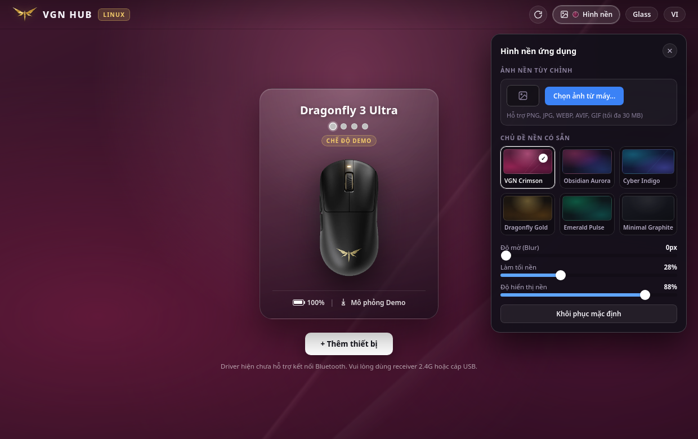
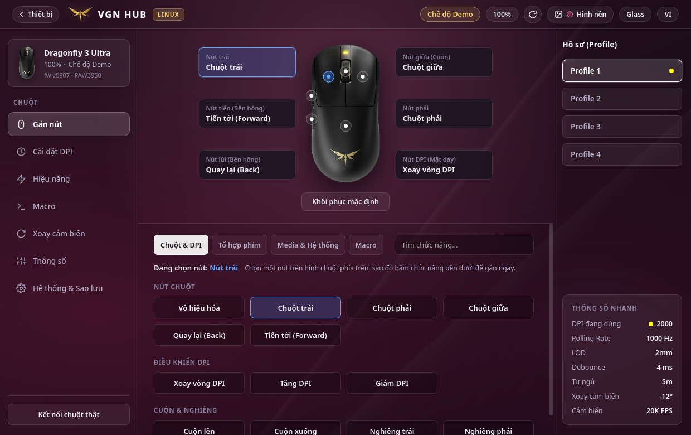
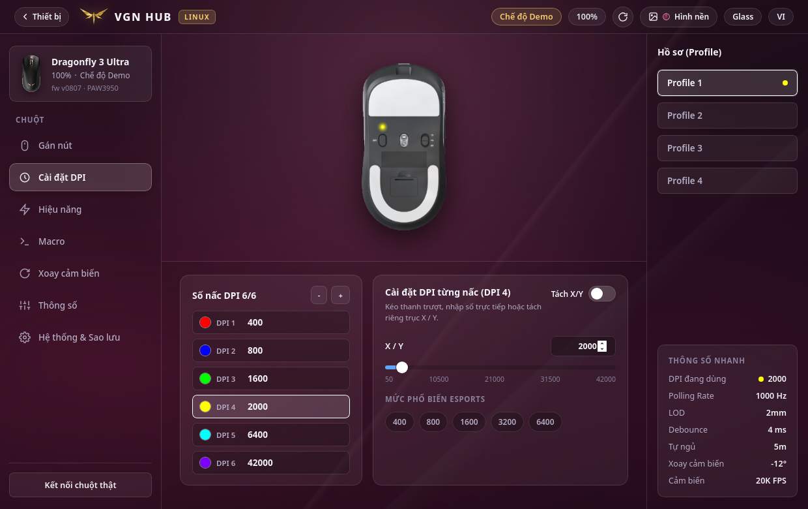
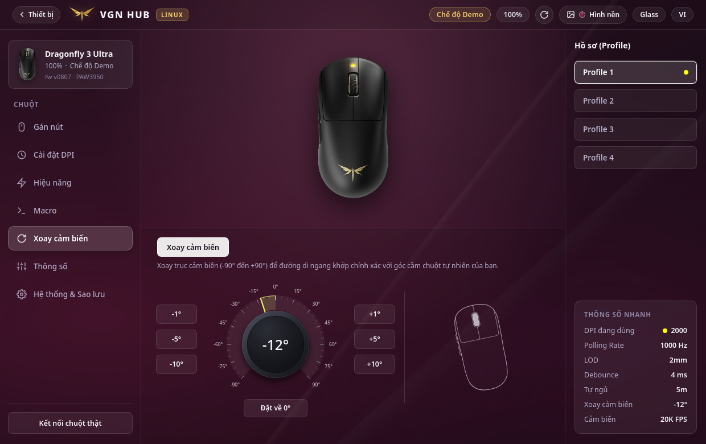

<div align="center">


# 🖱️ VGN Hub Linux

**GUI Desktop (GTK4 + Libadwaita + WebKitGTK6 Dark Glass) & CLI thuần Linux cho chuột VGN Dragonfly 3 Ultra và họ `vgn-ry-mouse`** — giao tiếp trực tiếp `/dev/hidraw*` bằng Python stdlib, **không cần `pip` hay `npm` ngoài**.

<p>
  <a href="https://github.com/hoangtl2/vgn-hub-linux/actions/workflows/test.yml">
    
  </a>
  
  
  
  
  
  <a href="LICENSE">
    
  </a>
</p>

<p>
  <a href="#demo">🖼️ Demo</a> ·
  <a href="#features">✨ Tính năng</a> ·
  <a href="#devices">🖱️ Thiết bị</a> ·
  <a href="#install">📦 Cài đặt</a> ·
  <a href="#usage">🚀 Sử dụng</a> ·
  <a href="#architecture">🏗️ Kiến trúc</a>
</p>

</div>

---

<a id="demo"></a>
## 🖼️ Demo giao diện

| 🏠 Device Lobby & Wallpaper Studio | 🖱️ Gán nút (Key Binding) |
|---|---|
|  |  |
| **🎯 Cài đặt DPI & Live LED mặt đáy** | **🧭 Xoay cảm biến (Sensor Rotation)** |
|  |  |

> [!TIP]
> Trải nghiệm ngay toàn bộ giao diện mà không cần cắm chuột bằng lệnh `vgn-hub-gui --demo`.

---

<a id="features"></a>
## ✨ Tính năng nổi bật

- 🏠 **Device Lobby & Quét HID**: Màn hình chờ chọn thiết bị, hộp thoại **+ Thêm thiết bị** quét `/dev/hidraw*`, kiểm tra quyền `udev` và đổi 4 màu vỏ (*Obsidian / Frost / Sakura / Sunset*).
- 🖼️ **Wallpaper Studio & Dark Glass / Solid**: 6 chủ đề nền gradient + ảnh tùy chỉnh (`PNG/JPG/WEBP/AVIF/BMP/GIF`, tối đa 30 MB, tự downscale `≤2560px`, tắt blur khi `blur = 0`), chuyển nhanh **Glass / Solid** và **VI / EN**.
- 🖱️ **Gán nút (6 nút)**: Ảnh render thật mặt trên với hotspot tương tác; gán nút chuột, DPI, cuộn/nghiêng, tổ hợp tối đa 3 phím, Multimedia/System, Macro hoặc Disable.
- 🎯 **DPI (1–6 nấc, `50–42,000 DPI`)**: Bước chỉnh 50, tách trục `X / Y`, preset Esports, đổi màu LED hiển thị trên **ảnh mặt đáy có live DPI LED** và đồng bộ nút DPI vật lý.
- ⚡ **Hiệu năng**: Polling Rate `125Hz → 8000Hz` và Sensor Sampling Rate (`Basic Mode` / `Supreme Competitive ≥20K FPS`).
- 🎹 **Macro (16 slot) & 🧭 Sensor Rotation (`-90°..+90°`)**: Ghi phím/chuột kèm độ trễ thực tế vào bộ nhớ chuột; núm xoay cảm biến có vạch chia và mô phỏng góc chuột realtime.
- 🔧 **Thông số cảm biến**: `LOD (0.7 / 1 / 2mm)`, `Latency (Stable / Extreme)`, `Motion Sync`, `Debounce (1..20ms)`, `Angle Snap`, `Ripple Control`, `Sleep Timer (10s..10m)`.
- 💾 **Profile 1–4, Sao lưu JSON & 🔋 Waybar**: Chuyển 4 profile, Backup/Restore JSON, Factory Reset và đọc `% pin` qua USB/2.4GHz xuất JSON cho **Waybar**.

---

<a id="devices"></a>
## 🖱️ Thiết bị hỗ trợ

Hỗ trợ họ giao thức `vgn-ry-mouse` (Vendor ID `391d`):

| Thiết bị | Sensor | DPI tối đa | Polling | USB Wired | Dongle 2.4GHz | Trạng thái |
|---|---|---|---|---|---|---|
| **VGN Dragonfly 3 Ultra** | `PAW3950` | `42,000` | `8000Hz` | `391d:1028` | `391d:1a25` | ✅ Đã kiểm chứng |
| **VGN Dragonfly F1 V5 Ultra** | `PAW3950` | `42,000` | `8000Hz` | `391d:102f` | `391d:1a2b` | 🧪 Cùng giao thức |
| **VGN Dragonfly F2 V2 Ultra** | `PAW3950` | `42,000` | `8000Hz` | `391d:1048` | `391d:1a41` | 🧪 Cùng giao thức |
| **VGN Dragonfly 3 Pro Max** | `PAW3395` | `36,000` | `8000Hz` | `391d:1004` | `391d:1a04` | 🧪 Cùng giao thức |
| **VGN Dragonfly Y2 V2 Pro Max** | `PAW3395` | `36,000` | `8000Hz` | `391d:1008` | `391d:1a08` | 🧪 Cùng giao thức |
| **VGN Dragonfly F1 V2 Pro Max** | `PAW3395` | `36,000` | `8000Hz` | `391d:1015` | `391d:1a13` | 🧪 Cùng giao thức |

> [!NOTE]
> `PAW3950` hỗ trợ LOD `0.7 / 1 / 2mm`, `PAW3395` hỗ trợ `1 / 2mm`; hiện chỉ hỗ trợ dây USB & receiver 2.4GHz (chưa hỗ trợ Bluetooth).

---

<a id="install"></a>
## 📦 Cài đặt

Yêu cầu Linux (`/dev/hidraw*`), **Python `>= 3.11`** và gói hệ thống **GTK4 + Libadwaita + WebKitGTK6** *(chỉ cần cho GUI; CLI chạy thuần Python stdlib)*:

| Distro | Lệnh cài đặt gói |
|---|---|
| 🎩 **Fedora** | `sudo dnf install python3-gobject gtk4 libadwaita webkitgtk6.0` |
| 🏔️ **Arch Linux** | `sudo pacman -S python-gobject gtk4 libadwaita webkitgtk-6.0` |
| 🟠 **Ubuntu / Debian** | `sudo apt install python3-gi gir1.2-gtk-4.0 gir1.2-adw-1 gir1.2-webkit-6.0` |

```bash
git clone https://github.com/hoangtl2/vgn-hub-linux.git
cd vgn-hub-linux
./scripts/install.sh

# Cấp quyền udev cho thiết bị VGN (VID 391d) để chạy không cần sudo
sudo cp packaging/99-vgn-hub.rules /etc/udev/rules.d/99-vgn-hub.rules
sudo udevadm control --reload-rules && sudo udevadm trigger
```

> [!TIP]
> Sau khi nạp `udev` rule, hãy **rút chuột/dongle ra cắm lại 1 lần**. Gỡ cài đặt bằng `./scripts/uninstall.sh`; cấu hình người dùng lưu tại `~/.config/vgn-hub-linux/`.

---

<a id="usage"></a>
## 🚀 Sử dụng

```bash
# 🖥️ Giao diện đồ họa
vgn-hub-gui                              # Mở GUI (hoặc chạy: vgn-hub)
vgn-hub-gui --demo                       # Chế độ Demo không cần cắm chuột

# ⌨️ CLI nhanh
vgn-hub status                           # Xem thông tin & trạng thái chuột (--json)
vgn-hub battery --waybar                 # Đọc % pin chuẩn JSON cho Waybar
vgn-hub profile 1                        # Chuyển Profile 1..4
vgn-hub dpi set 2 1600 --y 1800 --color "#00ff88"
vgn-hub polling 1000                     # 125 | 250 | 500 | 1000 | 2000 | 4000 | 8000
vgn-hub angle -5                         # Xoay cảm biến (-90..90)
vgn-hub params --lod 1 --debounce 4 --sleep 300 --motion-sync on --latency extreme --fps 20k
vgn-hub backup dragonfly-backup.json     # Sao lưu / khôi phục: vgn-hub restore <file>
```

<details>
<summary>📖 Bảng tham số CLI đầy đủ</summary>

| Lệnh | Tham số / Giá trị hợp lệ | Mô tả |
|---|---|---|
| `status` | `--json`, `--device <path>` | Xem thông tin phần cứng, pin, DPI và cấu hình |
| `battery` | `--waybar`, `--json`, `--device <path>` | Đọc % pin chuột (hỗ trợ Waybar) |
| `profile` | `[1\|2\|3\|4]`, `--device <path>` | Xem hoặc chuyển Profile 1–4 |
| `dpi` | `list` \| `active <1..6>` \| `count <1..6>` \| `set <1..6> <val> [--y <val>] [--color <#RRGGBB>]` | Quản lý các nấc DPI & màu LED |
| `polling` | `[125\|250\|500\|1000\|2000\|4000\|8000]` | Xem hoặc đặt Polling Rate (Hz) |
| `angle` | `[-90..90]` | Xem hoặc đặt góc xoay cảm biến |
| `params` | `--lod [0.7\|1\|2]`, `--debounce [1\|2\|3\|4\|8\|15\|20]`, `--sleep [10\|30\|60\|120\|300\|600]`, `--motion-sync`, `--angle-snap`, `--ripple [on\|off]`, `--latency [stable\|extreme]`, `--fps [basic\|20k]` | Xem hoặc chỉnh thông số cảm biến & thời gian ngủ |
| `backup` / `restore` | `<file>`, `--device <path>` | Xuất hoặc khôi phục cấu hình JSON |
| `gui` | `--demo` | Mở GUI (thêm `--demo` để mô phỏng) |

</details>

### 📊 Tích hợp Waybar (`~/.config/waybar/config.jsonc`)

```jsonc
"custom/vgn-mouse": {
  "exec": "vgn-hub battery --waybar",
  "return-type": "json",
  "interval": 30
}
```

*(Trong GUI mục **Hệ thống & Sao lưu** cũng có nút **Sao chép cấu hình** Waybar 1-click.)*

---

<a id="architecture"></a>
## 🏗️ Kiến trúc & 🧪 Kiểm thử

```text
vgn-hub-linux/
├── vgn-hub / vgn-hub-gui      # Wrapper CLI & GUI
├── vgn_hub/
│   ├── registry.py            # Khai báo DeviceSpec theo VID:PID
│   ├── transport.py           # /dev/hidraw* (HIDIOCSFEATURE/HIDIOCGFEATURE + thread DPI)
│   ├── keycodes.py            # Mã phím HID & mã hóa/giải mã gán nút
│   ├── config.py              # Helper thuần stdlib cho config JSON, Wallpaper Studio & serialize
│   ├── cli.py / gui.py        # CLI & Host GTK4 + WebKitGTK6 + DemoMouseSession
│   ├── protocols/             # Giao thức tách theo dòng sản phẩm (base.py, ry_mouse.py)
│   └── web/                   # Frontend HTML/CSS/JS/SVG + ảnh render thật (assets/)
├── packaging/ & scripts/      # udev rule, .desktop launcher, install.sh & uninstall.sh
└── docs/screenshots/ & tests/ # Ảnh demo giao diện & bộ unit test
```

Frontend `vgn_hub/web/` giao tiếp trực tiếp qua `user_content_manager` IPC (không mở cổng HTTP); `vgn_hub/config.py` và các lớp giao thức chạy thuần stdlib để unit test và CI vận hành không cần `PyGObject` hay phần cứng thật.

```bash
python3 -m unittest discover -s tests -v   # Chạy toàn bộ unit test (thuần stdlib)
./vgn-hub-gui --smoke-test                 # Smoke test mở cửa sổ GUI ở chế độ demo
```

GitHub Actions CI ([`.github/workflows/test.yml`](.github/workflows/test.yml)) kiểm thử tự động trên Python **3.11**, **3.12** và **3.13**.

---

## 📄 Giấy phép

[MIT License](LICENSE) · [CHANGELOG.md](CHANGELOG.md)
